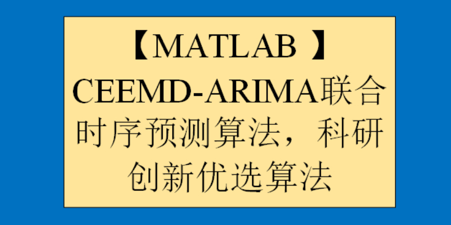

# [MATLAB] CEEMD-ARIMA Joint Time Series Forecasting Algorithm, Preferred Research and Innovation Algorithm

Intention to obtain the code, please refer to the end of this message for the method of obtaining the code~  
1. CEEMD Signal Decomposition Algorithm
CEEMD decomposition, also known as Complementary Ensemble Empirical Mode Decomposition, is an English abbreviation for Complementary Ensemble Empirical Mode Decomposition.  
CEEMD is an improvement on EMD, introducing an adaptive extension method based on EMD, which can better solve the mode mixing problem in EMD/EEMD. The main steps of CEEMD are as follows:  
Randomly perturb the original signal several times to obtain multiple noise perturbation datasets.  
Perform EMD decomposition on each noise perturbation dataset to obtain multiple EMD decomposition sets.  
For each EMD decomposition set, use an adaptive extension method to assign each local mode function to its corresponding intrinsic mode function, eliminating the influence of mode mixing.  
Average the corresponding components of each expanded EMD decomposition set to obtain the final CEEMD decomposition result. CEEMD decomposition has good locality and adaptability, can more accurately decompose signals, and avoids the mode mixing problem in EMD. Therefore, CEEMD has been widely used in signal processing, image processing, and pattern recognition fields.  
To use EMD decomposition in MATLAB, you first need to install the EMD decomposition MATLAB toolkit.  
EMD Toolkit Installation: Open the package_emd folder in MATLAB, run install_emd. M and index_emd. M as shown in the figure below to complete the toolkit installation.  
MATLAB Signal Decomposition Third Period - CEEMD:  
Details about signal decomposition family can be seen in:
2. ARIMA Time Series Forecasting Algorithm
The ARIMA (Autoregressive Integrated Moving Average) model is a predictive model based on time series analysis, suitable for analyzing and forecasting data with both temporal dependence and randomness. The ARIMA model was first proposed by Box and Jenkins in 1976 and has been widely used in the fields of production and finance for data prediction. The core idea of the ARIMA model is to perform differencing on the time series data to make it stationary, then establish the model through the combination of autoregression (AR) and moving average (MA), and use this model for forecasting. In the ARIMA model, "AR" stands for autoregression, indicating that the current data is related to the data from several previous moments; "I" stands for differencing, meaning to make the data stationary through differencing; "MA" stands for moving average, indicating that the current data is related to the errors from several previous moments. The establishment process of the ARIMA model includes three steps: model identification, parameter estimation, and model verification. In the model identification stage, the order of the ARIMA model and the number of differencing times need to be determined; in the parameter estimation stage, the model needs to be estimated; in the model verification stage, the model needs to be verified and judged whether the prediction accuracy meets the requirements. The ARIMA model has the advantage of fully utilizing the historical information of time series data for prediction, can adapt to various types of time series data, and has good explanatory power. However, there are some disadvantages to the ARIMA model, such as the need to perform differencing on non-stationary time series data, and the process of parameter estimation is relatively complex.
MATLAB | Time Series Forecasting | ARIMA Forecast Model:
For more details about the five time series forecasting schemes, please refer to:
3. CEEMD-ARIMA Joint Time Series Forecasting Algorithm Next, we will introduce in detail the principle and thought behind the latest CEEMD-ARIMA joint time series forecasting algorithm.
Signal decomposition can break down the raw data into N layers of imf components. In this study, we expand the ARIMA time series prediction for each layer's imf component and then reconstruct the predicted values of the imf components to obtain the CEEMD-ARIMA joint time series prediction values. 
By comparing the CEEMD-ARIMA joint time series prediction values with the pure ARIMA time series prediction values against the true values, we find that the CEEMD-ARIMA joint time series prediction algorithm has a good predictive effect. The reason is not difficult to see; signal decomposition divides the raw data into different frequency components, which means that the frequencies of each layer's imf component are roughly the same. This makes the data have good periodicity and regularity. Therefore, when using the ARIMA time series prediction algorithm to predict each layer's imf component, its predictive effect will be closer to the true value. 
Below is a brief video tutorial.

## Images

<!-- PAYMENT_BLOCK -->

## Get this dataset

- Payment link (Stripe): [Buy now](https://buy.stripe.com/3cs8yP7sY87d0vu9AB)
- Payment QR code: 

<!-- /PAYMENT_BLOCK -->
